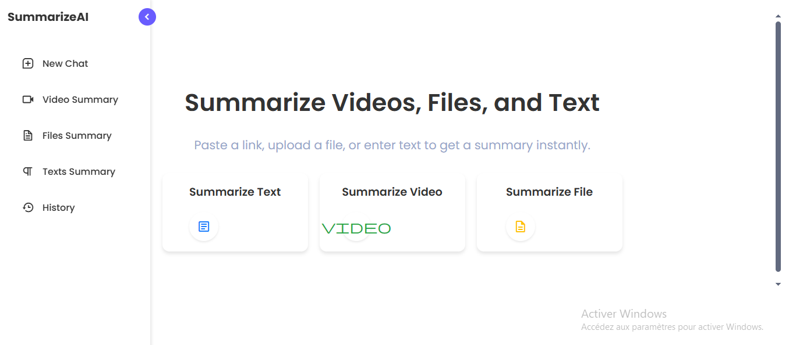
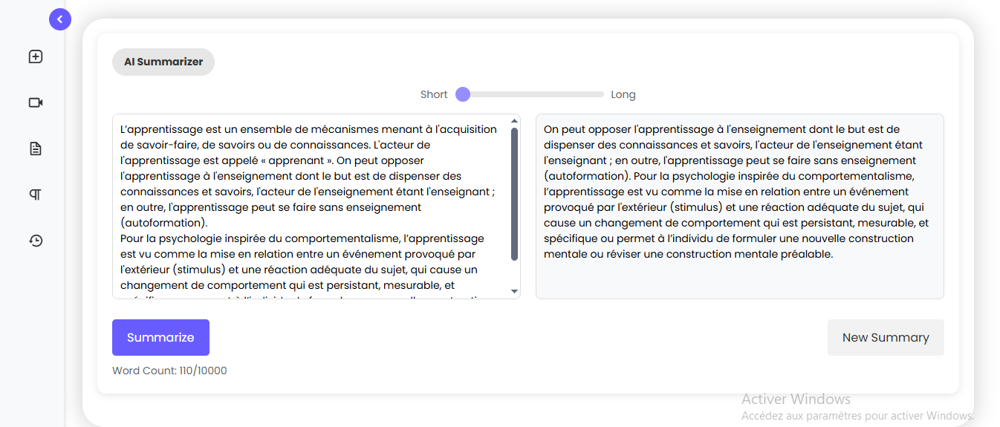
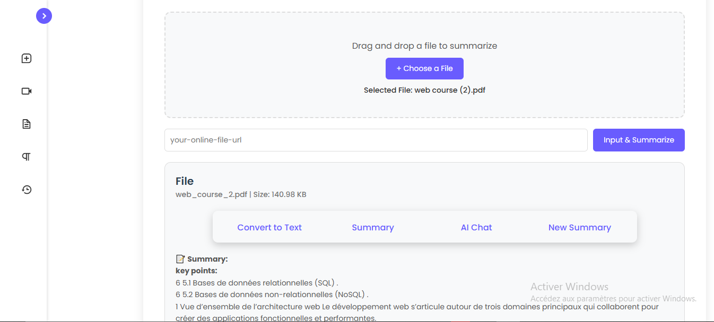
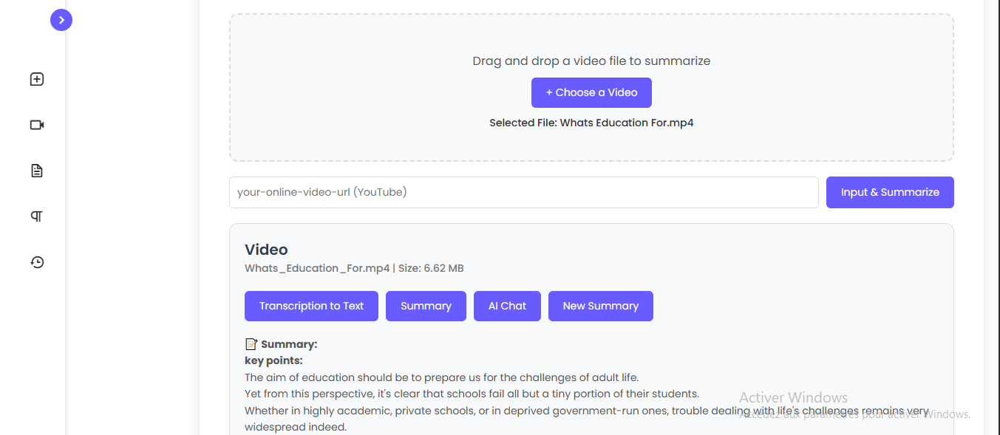
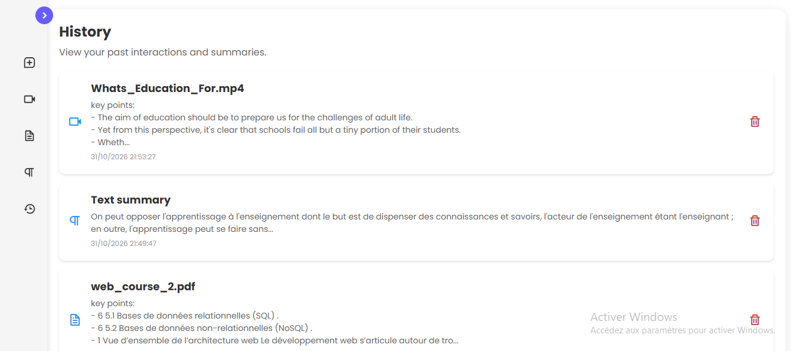

# SummarizeAI

[Français](README.md) | **English**

A Flask web application that automatically summarizes **text**, **documents** (TXT, PDF, DOCX) 
and **videos** (YouTube links or uploaded video files).

The summaries are **extractive**: the app scores the sentences of a text with TF-IDF and keyword frequency, then keeps the most relevant ones. 
Every result is saved in a local history.

## Screenshots

| Home | Text summary |
|---|---|
|  |  |

| File summary | Video summary |
|---|---|
|  |  |



## Context

Project carried out as the **final-year project (PFE)** of the DUT in Business Intelligence and Data Science at the École Supérieure de Technologie d'Essaouira (Cadi Ayyad University), academic year 2024-2025.


## Features

- **Text summary**: paste a text, choose the summary length and get the result.
- **File summary**: upload a `.txt`, `.pdf` or `.docx` file and get an overview with key points.
- **Video summary**:
  - paste a **YouTube link**: the app fetches the video information and transcript, then produces a summary with timestamps;
  - or upload a **video file** (`.mp4`, `.mov`, `.avi`): the audio is transcribed locally with Whisper, then summarized.
- **History**: previous summaries are stored in a SQLite database and can be reopened or deleted.
- Uploads are limited to 16 MB and are deleted after processing.

## Tech stack

- **Backend**: Python, Flask
- **NLP**: NLTK, scikit-learn (TF-IDF), NumPy
- **Documents**: PyPDF2, python-docx
- **Video**: youtube-transcript-api, pytubefix, faster-whisper
- **Database**: SQLite
- **Frontend**: HTML, CSS, JavaScript

## Installation

Requirements: Python 3.10 or newer and an internet connection (NLTK data and the Whisper model are downloaded on first use).

```bash
# 1. Clone the repository
git clone https://github.com/BENCHIKHMARIA/summarize-ai.git
cd summarize-ai

# 2. Create and activate a virtual environment
python -m venv venv
venv\Scripts\activate          # Windows
# source venv/bin/activate     # macOS / Linux

# 3. Install the dependencies
pip install -r requirements.txt

# 4. Run the application
python app.py
```

Then open **http://127.0.0.1:5000** in your browser.

### Optional settings

| Variable | Purpose |
|---|---|
| `SECRET_KEY` | Secret key used by Flask sessions. Set your own value outside of local testing. |
| `FLASK_DEBUG=1` | Enables Flask debug mode (development only). |

## Project structure

```
summarize-ai/
├── app.py              # Flask routes, database, file handling
├── main.py             # Text summarization (TF-IDF)
├── file_summary.py     # Document summarizer (UltimateSummarizer)
├── videosummary.py     # YouTube info, transcript and video summary
├── templates/          # HTML pages
├── static/             # CSS, JavaScript, images
├── uploads/            # Temporary uploads (content is not versioned)
├── screenshots/        # Images used in this README
└── requirements.txt
```

## Known limitations

- The summaries are extractive, so the app selects existing sentences instead of rewriting them.
- The user account pages (sign up / log in) are not finished yet, so the history is shared by anonymous sessions.
- YouTube summaries need a video that has an available transcript.

## About

Repository published by Maria Benchikh: [@BENCHIKHMARIA](https://github.com/BENCHIKHMARIA)
