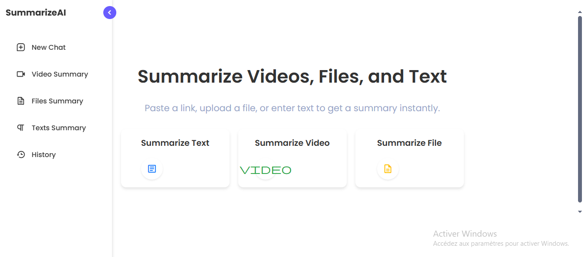
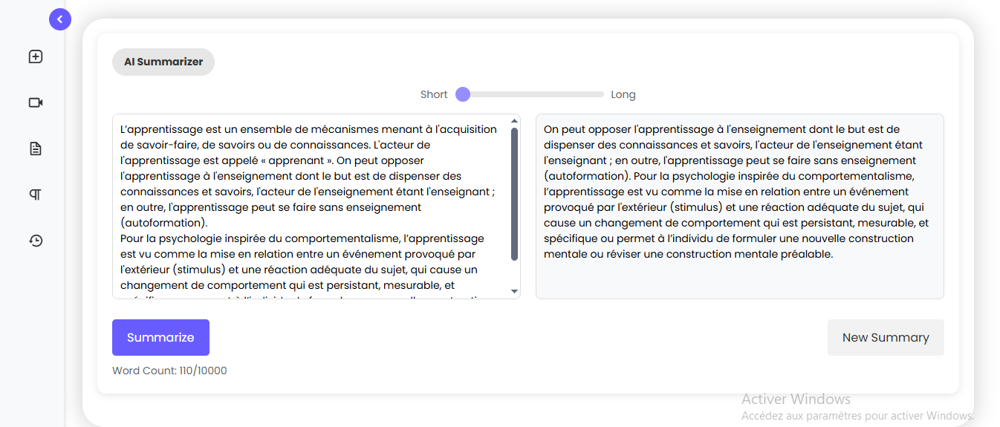
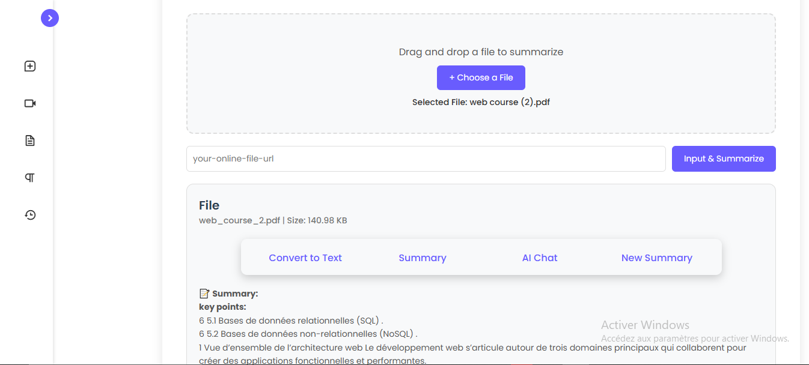
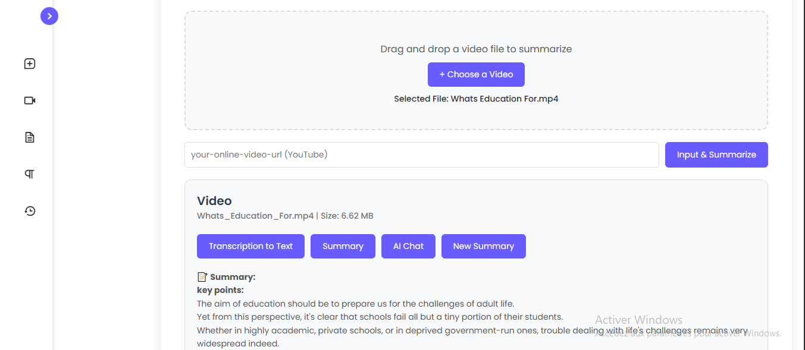
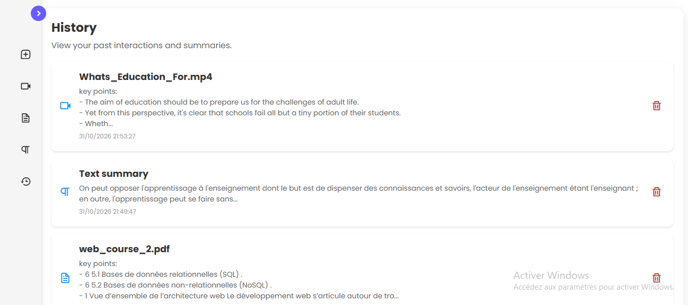

# SummarizeAI

**Français** | [English](README.en.md)

Application web Flask qui résume automatiquement des **textes**, des **documents** (TXT, PDF, DOCX) 
et des **vidéos** (liens YouTube ou fichiers vidéo importés).

Les résumés sont **extractifs** : l'application évalue les phrases d'un texte avec la méthode TF-IDF et la fréquence des mots-clés, puis garde les plus pertinentes. 
Chaque résultat est enregistré dans un historique local.

## Contexte

Projet réalisé dans le cadre du **projet de fin d'études (PFE)** du DUT en Informatique Décisionnelle et Sciences des Données, à l'École Supérieure de Technologie d'Essaouira (Université Cadi Ayyad), année universitaire 2024-2025.

## Captures d'écran

| Accueil | Résumé de texte |
|---|---|
| |  |

| Résumé de fichier | Résumé de vidéo |
|---|---|
| |  |



## Fonctionnalités

- **Résumé de texte** : coller un texte, choisir la longueur du résumé et l'obtenir.
- **Résumé de fichier** : importer un fichier `.txt`, `.pdf` ou `.docx` et obtenir une vue d'ensemble avec les points clés.
- **Résumé de vidéo** :
  - coller un **lien YouTube** : l'application récupère les informations et la transcription de la vidéo, puis produit un résumé avec les repères de temps ;
  - ou importer un **fichier vidéo** (`.mp4`, `.mov`, `.avi`) : l'audio est transcrit localement avec Whisper, puis résumé.
- **Historique** : les résumés précédents sont enregistrés dans une base SQLite, et peuvent être rouverts ou supprimés.
- Les fichiers importés sont limités à 16 Mo et sont supprimés après le traitement.

## Technologies

- **Backend** : Python, Flask
- **Traitement du langage** : NLTK, scikit-learn (TF-IDF), NumPy
- **Documents** : PyPDF2, python-docx
- **Vidéo** : youtube-transcript-api, pytubefix, faster-whisper
- **Base de données** : SQLite
- **Frontend** : HTML, CSS, JavaScript

## Installation

Prérequis : Python 3.10 ou plus récent, et une connexion internet (les données NLTK et le modèle Whisper sont téléchargés à la première utilisation).

```bash
# 1. Cloner le dépôt
git clone https://github.com/BENCHIKHMARIA/summarize-ai.git
cd summarize-ai

# 2. Créer et activer un environnement virtuel
python -m venv venv
venv\Scripts\activate          # Windows
# source venv/bin/activate     # macOS / Linux

# 3. Installer les dépendances
pip install -r requirements.txt

# 4. Lancer l'application
python app.py
```

Ouvrir ensuite **http://127.0.0.1:5000** dans le navigateur.

### Paramètres facultatifs

| Variable | Rôle |
|---|---|
| `SECRET_KEY` | Clé secrète utilisée par les sessions Flask. À définir avec une valeur personnelle hors test local. |
| `FLASK_DEBUG=1` | Active le mode debug de Flask (développement uniquement). |

## Structure du projet

```
summarize-ai/
├── app.py              # Routes Flask, base de données, gestion des fichiers
├── main.py             # Résumé de texte (TF-IDF)
├── file_summary.py     # Résumé de documents (UltimateSummarizer)
├── videosummary.py     # Infos YouTube, transcription et résumé vidéo
├── templates/          # Pages HTML
├── static/             # CSS, JavaScript, images
├── uploads/            # Fichiers importés temporairement (contenu non versionné)
├── screenshots/        # Images utilisées dans ce README
└── requirements.txt
```

## Limites connues

- Les résumés sont extractifs : l'application sélectionne des phrases existantes, elle ne les reformule pas.
- Les pages de création de compte et de connexion ne sont pas terminées, donc l'historique est partagé par des sessions anonymes.
- Le résumé YouTube nécessite une vidéo dont la transcription est disponible.

## À propos

Dépôt publié par Maria Benchikh : [@BENCHIKHMARIA](https://github.com/BENCHIKHMARIA)
